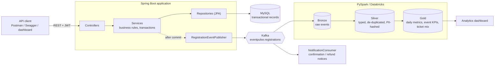
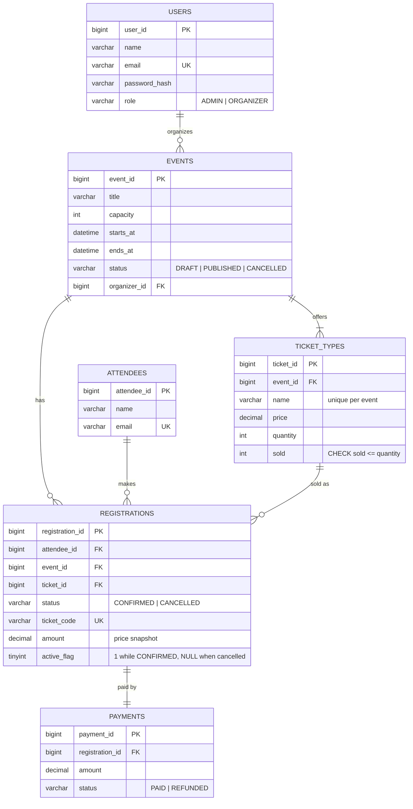

# EventPulse 360

**Event Management & Revenue Intelligence Platform** — a Spring Boot backend that runs events, registrations, tickets and revenue, and streams every booking into a PySpark Bronze → Silver → Gold analytics pipeline.

Picture a company conference with 1,000 attendees: the platform takes registrations, makes sure the last ticket is sold exactly once, tracks revenue and refunds, and turns the booking stream into business KPIs.

| Layer | Tech |
|---|---|
| API | Java 17, Spring Boot 3.5, Spring MVC, Bean Validation |
| Persistence | Spring Data JPA / Hibernate, MySQL 8, Flyway migrations |
| Security | Spring Security, stateless JWT, role-based access (`ADMIN`, `ORGANIZER`) |
| Messaging | Apache Kafka (producer after-commit + notification consumer) |
| Analytics | PySpark Bronze/Silver/Gold (Delta-ready, Databricks-compatible) |
| Docs & tooling | springdoc OpenAPI / Swagger UI, Postman collection, Docker Compose |
| Tests | JUnit 5, Mockito, Spring MockMvc, multi-threaded concurrency tests (H2) |

---

## Architecture



The API owns the *transactional truth* (MySQL). Kafka carries an immutable stream of "registration confirmed / cancelled" facts to the lakehouse, where Spark builds the historical analytics. The in-app `/api/analytics/*` endpoints cover live operational numbers straight from MySQL.

### Package layout

```
src/main/java/com/eventpulse
├── controller/   REST endpoints (thin: validation + delegation)
├── service/      business rules, transactions, locking, authorization checks
├── repository/   Spring Data JPA + the JPQL used for analytics and row locks
├── domain/       JPA entities and enums (TicketType owns the "reserve a seat" rule)
├── dto/          request/response records; never expose entities
├── security/     JWT service, auth filter, filter chain
├── messaging/    Kafka publisher/consumer and the event payload contract
├── exception/    domain exceptions + one @RestControllerAdvice
└── config/       typed properties, OpenAPI, Kafka topic, admin seeding
analytics/        PySpark medallion pipeline + sample data generator
docs/             Postman collection
```

---

## Database design



Schema lives in [`V1__init_schema.sql`](src/main/resources/db/migration/V1__init_schema.sql); Hibernate is set to `ddl-auto: none`, so Flyway is the single source of truth. Indexes cover the hot paths (`events(status, starts_at)`, `registrations(event_id, registered_at)`, `registrations(ticket_id)`).

The brief's `tickets` table is modelled as **`ticket_types`** (General, VIP, …) — each with its own price and inventory — because that is what actually gets oversold.

---

## The interesting part: preventing double booking

Two people click "Buy" on the last ticket at the same instant. Exactly one must win.

`RegistrationService.register` runs in one transaction and uses four layers of defence:

1. **Pessimistic row lock.** The ticket type is loaded with `SELECT … FOR UPDATE` (`@Lock(PESSIMISTIC_WRITE)`). Concurrent bookings for the same inventory queue up on that row.
2. **Check-then-act is now atomic.** While holding the lock, `TicketType.reserveSeat()` checks `sold < quantity` and increments. Loser → `SoldOutException` → `409`, transaction rolled back, nothing persisted.
3. **Database constraint.** `CHECK (sold >= 0 AND sold <= quantity)` means even a buggy future code path cannot oversell.
4. **No duplicate seats per person.** A unique key on `(attendee_id, event_id, active_flag)`, where `active_flag` is `1` while confirmed and `NULL` once cancelled (unique indexes ignore `NULL`s). One live registration per attendee per event, but cancel-and-rebook still works.

Cancellation locks the *registration* row first, then the ticket type, so double-cancelling cannot release the same seat twice. Lock acquisition has a 5 s timeout; a timeout surfaces as a retryable `409` instead of a hung request.

Why pessimistic rather than optimistic (`@Version`)? Under a ticket rush, contention on the last few seats is exactly when optimistic locking degenerates into retry storms. Locking a single short transaction is simpler and predictable. The trade-off is throughput on one hot ticket type; sharding inventory would be the next step.

**These claims are tested** in [`RegistrationConcurrencyTest`](src/test/java/com/eventpulse/service/RegistrationConcurrencyTest.java), with real threads released through a latch against a real database:

| Scenario | Result asserted |
|---|---|
| 25 buyers, 5 seats | exactly 5 succeed, 20 get `SoldOut`, `sold == 5` |
| same attendee submits 10× at once | exactly 1 succeeds, 9 get `Duplicate` |
| 6 simultaneous cancels of one registration | seat released exactly once |
| cancel, then re-register | allowed, inventory consistent |

Removing the `@Lock` line makes the first test fail (all 25 buyers get a seat) — the test genuinely guards the behaviour.

---

## Running it

### Option A — whole stack with Docker

```bash
docker compose up --build
```

MySQL, Kafka (KRaft) and the API start together. Swagger UI: <http://localhost:8080/swagger-ui.html>

### Option B — API only (no Kafka), local MySQL

```bash
# MySQL with a database/user matching application.yml, then:
mvn spring-boot:run
```

Kafka is **off by default** (`KAFKA_ENABLED=false`); the app is fully functional without it. Set `KAFKA_ENABLED=true` and `KAFKA_BOOTSTRAP_SERVERS` to enable the producer and notification consumer.

### Demo data

Start with the `demo` profile to load sample data (4 events incl. one sold out and one draft, ~390 bookings spread over two weeks, some refunds). It goes through the real services, so every business rule applies:

```bash
SPRING_PROFILES_ACTIVE=demo mvn spring-boot:run
```

Log in to the UI's Organizer tab (or `POST /api/auth/login`) as `demo@eventpulse.local` / `demo12345`.

### Web UI

A deliberately minimal single-page UI ships with the API (`src/main/resources/static/index.html`, plain HTML + JS, no build step). Open <http://localhost:8080/> to browse events and book a ticket, or use the **Organizer** tab to sign up, create events, add ticket types, publish, see sales and cancel/refund registrations.

### Configuration

| Variable | Default | Purpose |
|---|---|---|
| `DB_URL`, `DB_USERNAME`, `DB_PASSWORD` | local MySQL / `eventpulse` | datasource |
| `JWT_SECRET` | dev placeholder | HMAC key, **≥ 32 bytes — override outside local dev** |
| `ADMIN_EMAIL`, `ADMIN_PASSWORD` | `admin@eventpulse.local` / `ChangeMe123!` | bootstrap admin created on first start |
| `KAFKA_ENABLED`, `KAFKA_BOOTSTRAP_SERVERS` | `false` / `localhost:9092` | Kafka integration |

### Tests

```bash
mvn test
```

Tests use in-memory H2 (MySQL mode), so no Docker is needed.

---

## API overview

Interactive docs: Swagger UI at `/swagger-ui.html`, OpenAPI JSON at `/v3/api-docs`. A ready-made Postman collection is in [`docs/`](docs/EventPulse360.postman_collection.json) (run the folders top to bottom; it stores the JWT and ids for you).

| Method & path | Access | Purpose |
|---|---|---|
| `POST /api/auth/signup` · `POST /api/auth/login` | public | create organizer / get JWT |
| `GET /api/events` · `GET /api/events/{id}` | public | browse published events (drafts hidden) |
| `GET /api/events/{id}/ticket-types` | public | live availability |
| `POST /api/events/{eventId}/registrations` | public | book a seat |
| `GET /api/registrations/ticket/{code}` | public | look up a ticket |
| `POST /api/events` · `PUT/DELETE /api/events/{id}` | organizer/admin (owner) | manage events |
| `POST /api/events/{id}/publish` · `/cancel` | organizer/admin (owner) | lifecycle |
| `POST /api/events/{id}/ticket-types` | organizer/admin (owner) | add inventory (≤ capacity) |
| `GET /api/me/events` | authenticated | my events (all, for admin) |
| `GET /api/events/{id}/registrations` | owner | paged attendee list |
| `POST /api/registrations/{id}/cancel` | owner | cancel + refund + free the seat |
| `GET/POST/PUT /api/attendees` | authenticated | attendee records |
| `GET /api/analytics/overview` | authenticated | revenue & registration totals, top events |
| `GET /api/analytics/events/{id}` | owner | occupancy, sell-through, revenue by ticket type |
| `GET /api/analytics/events/{id}/registrations/daily?days=30` | owner | zero-filled daily trend |
| `GET /api/admin/users` | admin | list accounts |

Organizers only ever see and modify their own events; admins see everything. Errors share one JSON shape (`timestamp, status, error, message, path, fieldErrors`).

### Sample session

```bash
# 1. organizer signs up
TOKEN=$(curl -s localhost:8080/api/auth/signup -H 'Content-Type: application/json' \
  -d '{"name":"Olivia","email":"olivia@example.com","password":"password123"}' | jq -r .token)

# 2. create an event, add tickets, publish
EVENT=$(curl -s localhost:8080/api/events -H "Authorization: Bearer $TOKEN" -H 'Content-Type: application/json' \
  -d '{"title":"Annual Tech Summit","venue":"Hall A","capacity":1000,
       "startsAt":"2030-06-01T09:00:00Z","endsAt":"2030-06-02T18:00:00Z"}' | jq -r .id)
TICKET=$(curl -s localhost:8080/api/events/$EVENT/ticket-types -H "Authorization: Bearer $TOKEN" \
  -H 'Content-Type: application/json' -d '{"name":"General","price":120.00,"quantity":800}' | jq -r .id)
curl -s -X POST localhost:8080/api/events/$EVENT/publish -H "Authorization: Bearer $TOKEN"

# 3. an attendee books (no login needed)
curl -s localhost:8080/api/events/$EVENT/registrations -H 'Content-Type: application/json' \
  -d "{\"ticketTypeId\":$TICKET,\"attendeeName\":\"Ada Lovelace\",\"attendeeEmail\":\"ada@example.com\"}"

# 4. see the numbers
curl -s localhost:8080/api/analytics/events/$EVENT -H "Authorization: Bearer $TOKEN"
```

---

## Kafka events

Every state change publishes a `RegistrationEvent` (`REGISTRATION_CONFIRMED` / `REGISTRATION_CANCELLED`) to `eventpulse.registrations`, keyed by event id so one event's activity stays ordered on a partition.

- Published from a `@TransactionalEventListener(AFTER_COMMIT)`: consumers never see a booking that was rolled back.
- If Kafka is unreachable the booking still succeeds and the failure is logged. Guaranteed delivery would need a **transactional outbox** — a deliberate, documented trade-off.
- `NotificationConsumer` handles the "send confirmation / refund notice" use case (logged; plug in SMTP/SES).

## Analytics pipeline (PySpark, Bronze → Silver → Gold)

[`analytics/medallion_pipeline.py`](analytics/medallion_pipeline.py)

| Layer | What happens |
|---|---|
| **Bronze** | Raw payload landed append-only with lineage (`source`, `source_ref`, `ingested_at`). From Kafka via checkpointed `availableNow` structured streaming, or from JSON-lines files. No transformation. |
| **Silver** | Parse + type-cast, validate, **de-duplicate** (at-least-once delivery), **hash attendee email** (`sha2`) so PII stays in Bronze, add signed `net_amount` / `net_registrations`. Invalid rows go to `silver/_rejected`, not into the void. |
| **Gold** | `gold_daily_event_metrics` (registrations, cancellations, gross/refund/net revenue per event per day), `gold_event_kpis` (cancellation rate, avg ticket value, unique attendees), `gold_ticket_mix` (revenue share by ticket type). |

Try it without Kafka, inside a virtual environment:

```bash
cd analytics
python3 -m venv .venv
source .venv/bin/activate
pip install -r requirements.txt            # PySpark needs a JDK on the PATH
python generate_sample_events.py sample_data/events.jsonl
python medallion_pipeline.py --source files --input sample_data/events.jsonl --base-path ./lakehouse
```

Output lands in `analytics/lakehouse/{bronze,silver,gold}` as Parquet. (With the pip-installed PySpark, run the script with `python`; the bundled `spark-submit` wrapper can fail to locate Spark when the project path contains spaces.)

From Kafka (needs the connector, so use a real `spark-submit` from a Spark distribution): `spark-submit --packages org.apache.spark:spark-sql-kafka-0-10_2.12:3.5.1 medallion_pipeline.py --source kafka --kafka-bootstrap localhost:9092`.
On Databricks, pass `--format delta` and a `dbfs:/` or Unity Catalog volume path as `--base-path`.

---

## Design decisions & what I'd do next

- **DTO records everywhere**; entities never reach the wire. `TicketType` owns its inventory invariant instead of the service poking fields.
- **Authorization lives in one place** (`AccessPolicy`) and is enforced in services, not just URL rules, so a future endpoint can't forget it.
- **Login errors are uniform** (no user enumeration); JWTs are verified without a DB hit.
- **Price is snapshotted** on the registration, so changing a ticket price never rewrites history.
- Next steps: transactional outbox for Kafka, idempotency keys on `POST …/registrations`, rate limiting on public endpoints, refresh tokens, a real payment gateway behind `Payment`, and a Testcontainers suite against real MySQL/Kafka.

## Verification status

What has been run: `mvn test` (24 tests: JWT, service unit tests with Mockito, MockMvc API flows, concurrency tests) passes against H2, and the PySpark pipeline ran end to end in a venv on the generated sample file (443 lines in, 422 clean Silver rows, 3 rejected, 3 Gold tables).
What has **not** been run in the environment this was built in, and should be checked on first use: the Flyway migration and app on a real MySQL 8, `docker compose up`, the Kafka producer/consumer against a live broker, and the Kafka source of the pipeline.
